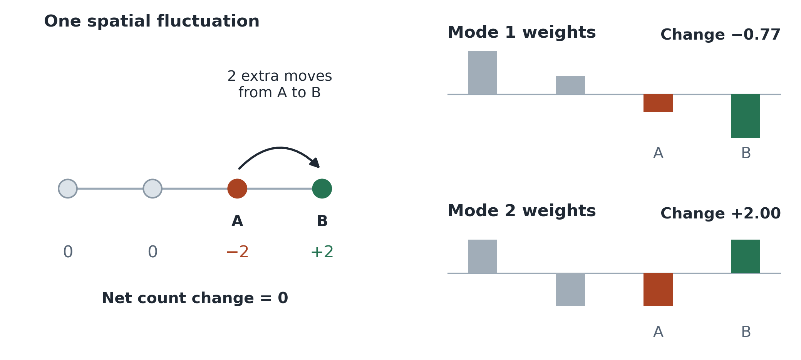
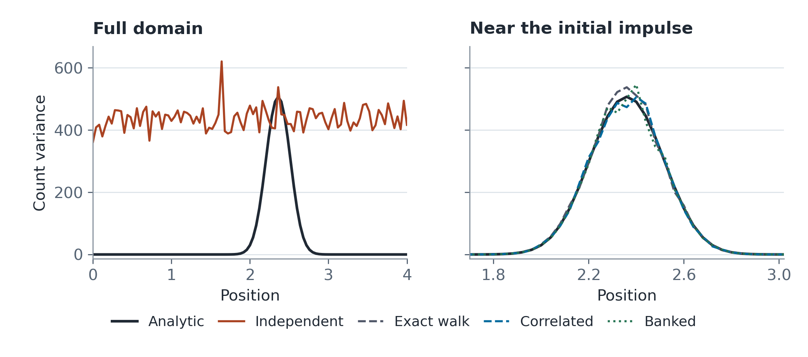
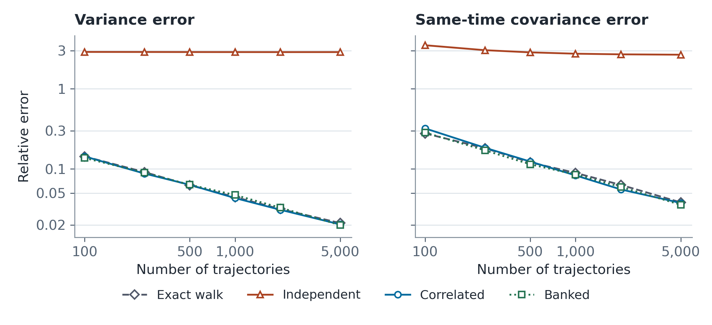

# EigenDiffusion before mode truncation

Full-rank project report · November 24, 2026

## What we set out to test

Can we simulate a noisy particle cloud by evolving spatial patterns called
**eigenmodes**? The first experiments kept every mode. On a 101-node grid,
all 101 modes together can represent any count profile on that grid. This let
us trace discrepancies to the model's update rule without losing spatial detail
in reconstruction.

The original model got the expected decay of the patterns right and produced
far too much fluctuation. Giving the modes a shared source of randomness
brought variance and covariance errors down to the level seen in finite
ensembles of the exact walk. A spatial ledger and projection then made the
reconstructed counts nonnegative while preserving the total number of
particles. These experiments established the statistical value of correlated
noise. The original full-rank correlated method had trajectory costs similar
to the aggregated exact walk in the archived benchmark.

## The same diffusion in two coordinate systems

Imagine placing all particles at one node on a line. During each time step,
each particle can stay or move one node. At the ends it can only stay or move
inward. The typical cloud spreads, while individual runs differ in how many
particles occupy each node.

The **exact aggregated walk** draws how many particles go left, stay, and go
right at each occupied node. This gives the same integer node-count process
as drawing a destination separately for every particle. Aggregation saves
work by keeping counts and dropping
particle identities. The analytic mean and covariance of this finite-step
walk provide targets for the statistical comparisons. The continuous-time
diffusion solution is a separate reference because it evolves over a finite
step differently.

An eigenmode is a fixed spatial pattern with a strength and a sign. The
constant pattern carries total mass. Broad patterns fade slowly and rapidly
alternating patterns fade quickly. Summing all patterns with their current
strengths reconstructs the field. In these coordinates the **expected**
update acts on each mode separately. The models differed mainly in how
they generated the random deviations around that update.

## How the three models update a trajectory

### Independent modal flips

The original EigenMarkov model represents each nonconstant mode by the
difference between two populations of signed units. Each unit can flip
sign, with a flip probability chosen to give that pattern the desired decay
on average. Units in different modes flip independently. These are
bookkeeping units in the eigenbasis. A signed pattern multiplied by an
integer can still yield fractional or negative reconstructed node counts.
The default initialization also rounds the modal strengths to the nearest
unit.

The rule gives the correct expected decay for the state it represents. Its
random fluctuations have the wrong structure. A physical particle move
changes the strength of several patterns at once, so the fluctuations those
patterns see are related. Independent random flips omit that relationship.

### Shared spatial Gaussian debit and credit

The correlated model starts each step with the expected diffusion update.
At each source node it draws a joint Gaussian deviation for the left, stay,
and right counts around their expected values. The deviations from any one
source add to zero. If two more particles than expected move from A to B,
and two fewer stay at A, the fluctuation takes 2 from A and adds 2 to B.
The simulation accumulates such deviations into one spatial field and
projects that field onto every mode. The modes respond differently according
to their shapes, yet their responses arise from the same draw.

{width=91%}

For a given nonnegative source state, the sampler uses the same conditional
covariance as the multinomial transfers. Its draws are continuous and
unbounded. The raw reconstruction can therefore have negative values, and the
implementation uses a nonnegative, mass-preserving projection of that
field when setting the next draw's noise intensity. The model continues to
evolve and return the raw field.

### Banked correlated dynamics

The banked variant adds a spatial ledger. It adds the previous ledger balance
to the raw candidate and projects the result onto the set of nonnegative
fields with the correct total mass. This projection is the smallest
Euclidean correction that satisfies both constraints. The ledger carries
the difference forward so that the next step can account for the
correction. The corrected field also supplies the state for the next
modal update and noise draw.

This gives a nonnegative, mass-conserving trajectory with generally fractional
counts. An early follow-up applied the correction **after** generating the
trajectory, which kept the simulated dynamics fixed and isolated the effect of
the readout. Its temporal and neighbor-coupled Delta-Sigma variants used
integer quantization with residual feedback to produce nonnegative integer
counts that sum to the particle total. Those constraints alone leave the
probabilities of individual integer trajectories undetermined. [Model definitions](MODAL_MODELS.md) · [Integer readouts](DELTA_SIGMA_READOUTS.md)

## Accuracy at full rank

The core comparison used 5,275 particles on a reflecting 4 µm line, with all
particles at node 59 initially (zero-based index, position 2.36 µm).
Each trajectory saved 101 states from 0 to 100 µs at 1 µs intervals. The
diffusion coefficient was 0.00022 µm²/µs. The study used 101 of 101 modes,
500 trajectories per method, and experiment seed 0.

### Mean and second moments

All three error columns are relative to the analytic moments of the same
finite-step walk. Mean and variance use the entire time-by-node field.
Covariance compares all node pairs at 1, 5, 20, 50 and 100 µs. Sampling
only 500 trajectories gives the exact walker nonzero errors too. Its row
shows the scale of sampling error in this experiment.

| Method | Mean error | Variance error | Covariance error |
| --- | ---: | ---: | ---: |
| Exact aggregated walk | 0.001648 | 0.0619 | 0.1213 |
| Independent modal | 0.005300 | 2.8810 | 2.8350 |
| Correlated modal | 0.001644 | 0.0600 | 0.1210 |
| Banked correlated | 0.001827 | 0.0612 | 0.1258 |

[Archived 500-trajectory results](../outputs/presentation/01_modal_models.csv)

The independent model's sampled mean looks close on the scale of the whole
profile, even though its variance and covariance relative errors exceed 2.8.
The correlated and banked models have similar errors to the exact ensemble
on all three measures. The raw correlated mean follows the expected update
because its Gaussian deviation is centered. The banked model's mean and
covariance are evaluated empirically because the projection changes the update.

{width=95%}

### Physical output

| Method | Negative entries | Mean negative mass | Most negative count | Max mass error, counts |
| --- | ---: | ---: | ---: | ---: |
| Exact aggregated walk | 0% | 0% | 0 | 0 |
| Independent modal | 40.39% | 12.42% | −102.69 | \(1.0\times10^{-11}\) |
| Correlated modal | 34.57% | 0.0196% | −3.22 | \(9.1\times10^{-12}\) |
| Banked correlated | 0% | 0% | 0 | \(9.1\times10^{-13}\) |

The raw correlated model still goes below zero frequently, but the mean
negative mass is about **630 times smaller** than for independent flips.
Negative entries count affected node-time values. Negative mass measures
their magnitude relative to the particle total, so many small violations
can coexist with very little negative mass. The bank removed the remaining
violations and carried an average absolute balance of 0.0528% of total mass.
Every method conserved total mass to floating-point precision or better.
[Archived physicality and bank diagnostics](../outputs/presentation/01_modal_models.csv)

### What changes with more trajectories

A later convergence study reevaluated the same full-rank models with nested
ensembles of 100 to 5,000 trajectories and experiment seed 20. The variance
and covariance errors for both correlated variants fall along with those of
the exact ensemble. The independent model's errors level off. At 5,000
trajectories its relative variance and covariance errors remain 2.876 and
2.667. The corresponding ranges across the exact walk and the two correlated
variants are 0.0199–0.0210 and 0.0356–0.0382. The independent model's sampled
mean error is 3.23 times the exact walk's expected Monte Carlo standard-error
norm, compared with 1.00–1.15 for the other methods. The independent rule's
excess variance makes its sample mean noisier as well.
[Convergence protocol](TRIAL_COUNT_CONVERGENCE.md) · [Convergence data](../outputs/convergence/core_models_r5000.csv)

{width=95%}

## Performance at full rank

The archived comparison timed the original aggregated multinomial and
full-rank correlated models on the same 101-node workload, with five
trajectory repeats. The exact walk took 20.14 ms per trajectory. The
correlated model took 19.76 ms after 193.24 ms of measured setup, with
213.00 ms for setup plus one trajectory. The exact setup was approximately
0.007 ms. Reachable arrays after one run occupied 0.078 MiB for the exact
walk and 0.313 MiB for the correlated model. The archived experiment
established similar prepared trajectory times for these two paths.
[Archived performance measurements](../outputs/presentation/05_performance.csv)

### Timing the original models on the current code

A fresh benchmark used the same grid, duration, particle count, and initial
condition as the accuracy study. Each method produced all 101 saved count
fields. The modal APIs also returned their native diagnostic histories.
The run used two warmups, 24 measured repeats per method, and rotated the
order of methods across repeats. It ran on one core of an Intel Xeon
E5-1660 with Python 3.11.2 and NumPy 1.24.2, using one numerical thread.

| Method | Setup, ms | Simulation, ms | Simulation IQR, ms | Setup + simulation, ms |
| --- | ---: | ---: | ---: | ---: |
| Exact particle-by-particle walk | 0 | 271.724 | 270.013–273.221 | 271.724 |
| Exact aggregated walk | 0 | 24.381 | 24.089–24.664 | 24.381 |
| Independent modal | 1.784 | 9.550 | 9.531–9.617 | 11.334 |
| Correlated modal | 1.778 | 20.107 | 20.048–20.174 | 21.885 |
| Banked correlated | 1.779 | 21.908 | 21.831–21.976 | 23.688 |

Setup and simulation columns give medians. The IQR runs from the 25th to 75th
percentile of the simulation times. The combined column adds the two
medians. Modal setup includes constructing the full eigenbasis. The exact
walks have no separately timed setup, so the simulation column includes the
entire call from the shared configuration. The older and newer setup
measurements use different protocols.

Aggregation makes the exact walk about 11 times faster than its
particle-by-particle version here. The raw correlated model takes about
20 ms per trajectory in both experiments. Banking adds roughly 9% to its
prepared run time in the fresh benchmark. The independent model is the
fastest original modal variant and has the largest statistical errors.
[Fresh timing samples](../outputs/full_rank_report/timing.json)

### Retained array storage

| Method | Setup, KiB | Extra held by result, KiB | Setup + result, KiB |
| --- | ---: | ---: | ---: |
| Exact particle-by-particle walk | 0 | 79.70 | 79.70 |
| Exact aggregated walk | 0 | 79.70 | 79.70 |
| Independent modal | 80.48 | 319.57 | 400.05 |
| Correlated modal | 81.38 | 239.09 | 320.47 |
| Banked correlated | 81.38 | 398.48 | 479.86 |

Every method returns a count history of 79.70 KiB. Modal results also keep
arrays such as modal amplitudes, signed populations, noise-source fields,
or ledger histories. Setup and result columns count shared backing arrays
once. These are retained NumPy arrays after the call. Peak process memory,
which includes temporary particle histories and numerical workspaces,
requires separate instrumentation.

## What the full-rank experiments established

The three models distinguish three goals. Independent flips give the
expected modal decay. Shared spatial fluctuations recover the tested
statistical scale of the exact walk. Banking additionally enforces the
physical bounds of the returned field. Keeping all patterns makes this a
comparison of update rules at the same spatial resolution.

The exact walk gives integer transitions whose probabilities depend on the
realized source counts. The Gaussian model replaces those laws with
continuous deviations, and the bank applies a nonlinear correction.
Matching mean, variance and same-time covariance leaves open how often a
node is empty, how probable extremes are, and how likely entire trajectories
are. For example, at node 72 and time 50 µs, the exact empty-node
probability is 28.2% from the binomial law. In the archived 500 trajectories,
25.8% of exact-walk samples and 15.0% of banked samples at that point were
empty. This single low-occupancy example shows how similar aggregate
moment errors can coexist with a different local distribution.
[Archived trajectories](../outputs/presentation/01_modal_models.npz)

The full-rank implementation also retains a dense basis, samples on the
spatial grid, and reconstructs the field throughout the run. Banking adds
projection and additional full-grid state. These costs established the
performance baseline for any subsequent attempt to reduce the problem.

## Appendix A. Exact walk and modal updates

### Grid and exact reference

Let \(J\) be the number of nodes, \(N\) the particle count, \(L\) the line
length, \(D\) the diffusivity, \(\Delta t\) the timestep, and
\(\Delta x=L/(J-1)\) the grid spacing. Time index \(t\) corresponds to
physical time \(t\Delta t\). At an interior source node the left, stay, and
right probabilities are \((q,1-2q,q)\), where
\(q=D\Delta t/\Delta x^2\). An endpoint has inward probability \(q\) and
stay probability \(1-q\). Here \(q=0.1375\).

Let \(A\) be the positive-semidefinite reflecting graph Laplacian scaled by
\(D/\Delta x^2\), and let \(P=I-\Delta t A\) be the symmetric one-step
transition matrix. All state vectors below are columns. If \(n_t\) is the
integer spatial count vector, then \(\mathbb E[n_{t+1}\mid n_t]=Pn_t\).
The one-particle probability vector \(p_t\) evolves as \(p_{t+1}=Pp_t\),
starting with probability one at the impulse node. At each saved time,
the \(N\) independent particles give

\[
n_t\sim\operatorname{Multinomial}(N,p_t),\qquad
\mu_t=Np_t,\qquad
\Sigma_t=N\bigl[\operatorname{diag}(p_t)-p_t p_t^\top\bigr].
\]

Here \(\mu_t\) is the mean, \(\Sigma_t\) is the spatial covariance, and
the reference variance vector \(v_t\) is the diagonal of \(\Sigma_t\).

### Full modal coordinates and independent flips

Write \(A=V\Lambda V^\top\), where each column \(v_k\) of the orthonormal
matrix \(V\) is an eigenmode and \(\lambda_k\) is its eigenvalue in the
diagonal matrix \(\Lambda\). For the spatial field \(x_t\), its modal
coordinates are \(a_t=V^\top x_t\) and \(x_t=Va_t\). The expected walk
update in these coordinates multiplies by
\(\Gamma=I-\Delta t\Lambda\). The constant mode has \(\lambda_0=0\) and
strength \(N/\sqrt{J}\) for the positive constant eigenvector.

The independent model represents mode \(k>0\) by
\(a_{t,k}=w(u^+_{t,k}-u^-_{t,k})\), where \(w\) is the unit weight and
\(u^+_{t,k}\) and \(u^-_{t,k}\) are the positive and negative populations.
Each unit flips sign with probability \(\pi_k=\lambda_k\Delta t/2\).
As one flip changes the sign of the unit's contribution, the conditional
mean obeys

\[
\mathbb E[a_{t+1,k}\mid a_{t,k}]
=(1-2\pi_k)a_{t,k}=(1-\lambda_k\Delta t)a_{t,k}.
\]

In general \(V^\top\Sigma_t V\) has nonzero off-diagonal entries. Its modal
covariances are absent from independent flips.

### Shared Gaussian innovations

For source \(i\), let \(s_i\ge0\) denote its source count or physical proxy,
and let \(\rho_i\) be the vector of valid destination probabilities. The
centered transfer vector for that source has target covariance

\[
Q_i=s_i\bigl[\operatorname{diag}(\rho_i)-\rho_i\rho_i^\top\bigr].
\]

The Gaussian construction draws \(z_i\) with independent standard-normal
entries, forms \(g_i=\operatorname{diag}(\sqrt{\rho_i})z_i\), and uses
\(\delta_i=\sqrt{s_i}[g_i-\rho_i(\mathbf 1^\top g_i)]\). The vector
\(\mathbf 1\) has all entries equal to one, so \(\mathbf 1^\top\delta_i=0\)
and \(\operatorname{Cov}(\delta_i\mid s_i)=Q_i\). The implementation draws
independently over sources and adds each \(\delta_i\) to its destination
nodes. If \(\xi_t\) denotes the resulting spatial fluctuation, then

\[
a_{t+1}=\Gamma a_t+V^\top\xi_t.
\]

A fluctuation of size \(h\) from node \(i\) to node \(j\) changes mode \(k\)
by \(h[v_k(j)-v_k(i)]\). This is zero for the constant mode. The same
\(h\) appears in every modal update it affects, which accounts for the
cross-mode correlation.

### Physical projection and ledger

Define the fixed-mass simplex
\(\mathcal S_N=\{y:\ y_i\ge 0,\ \mathbf 1^\top y=N\}\).
Let \(x^\ast_{t+1}\) be the raw candidate obtained from the banked model's
modal update and \(b_t\) the previous ledger. Its adjusted candidate is
\(z_{t+1}=x^\ast_{t+1}+b_t\). The steps at full rank are

\[
y_{t+1}=\arg\min_{y\in\mathcal S_N}\tfrac12\|y-z_{t+1}\|_2^2,\qquad
b_{t+1}=z_{t+1}-y_{t+1},\qquad a_{t+1}=V^\top y_{t+1}.
\]

The identity \(VV^\top=I\) makes the implementation's ledger
\(z_{t+1}-VV^\top y_{t+1}\) equivalent to the expression above up to
roundoff. The output-only continuous readout uses the same projection and
ledger while keeping the original trajectory as input. The temporal integer
readout replaces the continuous projection with a fixed-mass integer
quantizer.

## Appendix B. Error and cost measures

For \(R\) trajectories the sample mean \(\widehat\mu_t\) is the average
spatial field. The sample covariance \(\widehat\Sigma_t\) is the average of
the outer products of deviations from that mean, with divisor \(R\).
Its diagonal gives the sample variance \(\widehat v_t\). Let
\(\mathcal T\) be the five selected covariance times and
\(\|\cdot\|_F\) the square root of the sum of squared entries. The relative
errors are

\[
E_\mu=\frac{\|\widehat\mu-\mu\|_F}{\|\mu\|_F},\qquad
E_v=\frac{\|\widehat v-v\|_F}{\|v\|_F},\qquad
E_\Sigma=
\sqrt{\frac{\sum_{t\in\mathcal T}\|\widehat\Sigma_t-\Sigma_t\|_F^2}
{\sum_{t\in\mathcal T}\|\Sigma_t\|_F^2}} .
\]

The mean and variance norms stack all saved times and nodes. The sampled
mean error relative to the exact-walk standard-error norm is
\(\|\widehat\mu-\mu\|_F/\|\sqrt{v/R}\|_F\). A value around one is consistent
with the exact walk's sampling scale.

For a returned frame \(y\), negative mass is
\(\sum_i\max(-y_i,0)/N\), averaged over trajectories and saved times for the
table. The negative-entry fraction counts entries below \(-10^{-12}\).
The mass error is the maximum of \(|\mathbf 1^\top y-N|\) over all frames.
The mean bank fraction averages \(\|b_t\|_1/N\) over the banked runs, where
\(\|\cdot\|_1\) sums absolute values.

For timing, let \(t_s\) be one-time setup cost and \(t_r\) median time for a
prepared trajectory. The derived setup-plus-one cost is \(t_s+t_r\).
There are \(2^{10}\) bytes per KiB and \(2^{20}\) bytes per MiB. Reachable
NumPy array storage measures the unique backing arrays held by the prepared
object and returned result. It excludes the interpreter, libraries, and
freed temporary arrays.

## Appendix C. Reproducing the accuracy studies

Run from the repository root with the package installed. These commands
write in a separate output directory.

~~~bash
python -m eigendiffusion compare-modal-models \
  --nodes 101 --modes 101 --particles 5275 --steps 101 \
  --impulse-index 59 --dt 1 --length 4 --diffusion 0.00022 \
  --covariance-times 1 5 20 50 100 --runs 500 --seed 0 \
  --output outputs/full_rank_report/core.png \
  --csv-output outputs/full_rank_report/core.csv

python -m eigendiffusion study-trial-convergence \
  --nodes 101 --modes 101 --particles 5275 --steps 101 \
  --impulse-index 59 --dt 1 --length 4 --diffusion 0.00022 \
  --covariance-times 1 5 20 50 100 --seed 20 \
  --trial-counts 100 250 500 1000 2000 5000 \
  --output outputs/full_rank_report/convergence.png \
  --csv-output outputs/full_rank_report/convergence.csv
~~~

The original framework, correlated dynamics, and integer readouts entered
the codebase in commits baa8f7a, 71ebf8f, and eecd98f, respectively. The
discrete reference and diagnostics were introduced in 1da12ec. The new
timings used revision 6866759. The timing artifact records the configuration,
paired repeat seeds via the base seed, repeat counts, and raw samples.
[Implementation summary](IMPLEMENTATION_UPDATE.md) · [Reference derivations](MATH.md) · [Timing data](../outputs/full_rank_report/timing.json)
