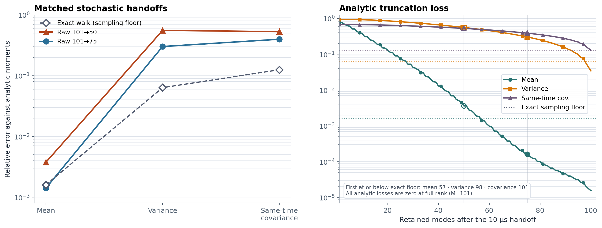
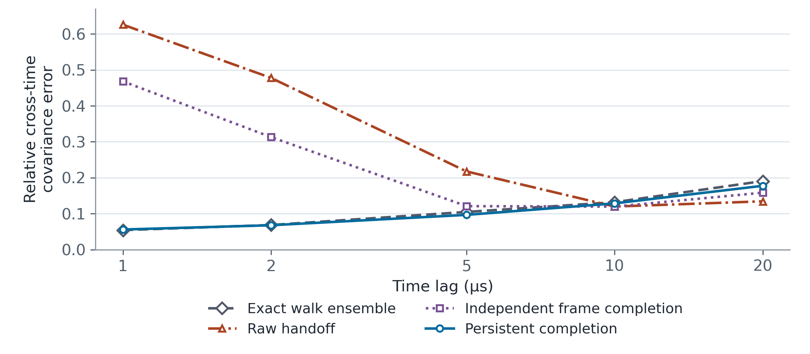
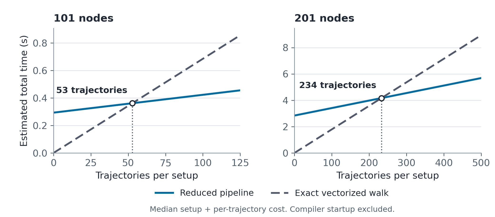

# EigenDiffusion with truncated eigenmodes

Reduced-mode project report · November 25, 2026

## What truncation buys and what it loses

A diffusion cloud can be described as a sum of spatial patterns called
eigenmodes. Broad patterns decay slowly. Fine patterns fade rapidly in the
expected cloud, so evolving fewer of them seems like a way to save work.
The reduced-mode experiments started with a question: how much of the
random cloud can we recover after dropping those fine patterns?

The early experiments showed that a good average profile can hide a large
loss of variance and covariance. The current model restores much of that
missing fluctuation by sampling a small number of correlated noise directions
at each transition. When many trajectories reuse one prepared configuration,
it delivers full nonnegative fields faster than the exact vectorized
count walk at the two tested grid sizes. Preparation is still expensive,
and the output follows a continuous approximation to the integer walk.
The companion report covers the models that established the full-rank
reference. [Full-rank project report](FULL_RANK_PROJECT_REPORT.md)

## From a timed handoff to useful completion

### Keep more modes while the impulse spreads

The initial condition places every particle at one grid node. That sharp
spike needs many patterns to describe it. The handoff model evolves all 101
modes for the first 10 µs, projects the field at 10 µs, then evolves the
slowest 50 or 75 modes, including the constant mode that carries total mass.
These two choices use 54.6% and 76.8% of full-rank modal coordinate updates.
Wall-clock cost also includes sampling noise on the spatial grid and
reconstructing the full field.

The averaged field survived the switch much better than the fluctuations.
The fine patterns contribute little to the late-time mean, but random jumps
continually excite them. Projecting them away removes part of the cloud's
variance and changes which locations fluctuate together. Figure 1 holds
the handoff time at 10 µs to isolate the effect of the retained count. The
earlier handoff-selection study also varied the switch time. Its analytic
targets selected 75 modes at 30 µs, with predicted variance and same-time
covariance errors of 0.240 and 0.274 and 82.0% of full modal-update work.
[Handoff selection study](HANDOFF_SELECTION.md)

### Fill in the missing detail

The first completion treated each saved field as a reconstruction problem.
Given the retained coefficients, it used the exact walk's same-time
statistics to estimate the likely omitted coefficients. It then drew
correlated Gaussian residuals to restore variability around that estimate.
Ten residual directions were enough in the representative experiment to
bring the variance and same-time covariance errors near those of the exact
sample. The retained path stayed fixed.

Same-time completion drew a fresh residual for every frame. If an omitted
pattern was unusually strong in one frame, that draw gave the next frame no
memory of the event. **Persistent completion** carried the omitted state
forward and used it together with the observed retained transition to
predict the next omitted state. It then added the newly unpredictable part.
That carried fluctuations across time and became the trusted reference for
the handoff pipeline. A separate simplex readout could enforce physical
output after completion. [Same-time completion](UNRESOLVED_GAUSSIAN_COMPLETION.md) · [Persistent completion](PERSISTENT_UNRESOLVED_COMPLETION.md) · [Physical completion study](COMPLETION_SELECTION.md)

### What the handoff experiments measured

Each ensemble contains 500 trajectories of 5,275 particles on 101 nodes,
with an impulse at 2.36 µm on the reflecting 4 µm line. Each trajectory
has 101 saved fields from 0 to 100 µs. Both raw handoffs switch at 10 µs.
The two completion rows use the 50-mode handoff with residual rank 10. All errors
are relative to the analytic walk. The first three error columns use base
seed 1, with same-time covariance scored at 1, 5, 20, 50, and 100 µs. The lag
columns use base seed 3 and average cross-time covariance over valid origins
from 10 µs onward. Within each experiment the raw handoffs use the same
random seeds.

| Model | Mean | Variance | Same-time covariance | Lag 1 µs | Lag 5 µs |
| ----------------------------- | -------: | --------: | ---------------: | --------: | --------: |
| Exact walk | 0.00160 | 0.0635 | 0.1250 | 0.0542 | 0.1048 |
| 101→50 raw | 0.00377 | 0.5558 | 0.5297 | 0.6260 | 0.2174 |
| 101→75 raw | 0.00142 | 0.3016 | 0.3973 | 0.3945 | 0.0958 |
| 50, same-time completion | 0.00163 | 0.0633 | 0.1210 | 0.4682 | 0.1209 |
| 50, persistent completion | 0.00164 | 0.0610 | 0.1244 | 0.0558 | 0.0966 |

Keeping 75 instead of 50 modes lowered the mean, variance, and same-time
covariance errors by 62%, 46%, and 25%, respectively. The mean error reached
the scale of the exact ensemble, while the variance and covariance errors
were still about 4.7 and 3.2 times their exact-ensemble references. The lag
error fell by 37% at 1 µs and 56% at 5 µs. At 20 µs it rose from 0.1343 to
0.1626 in this sample. The 50-mode persistent completion restored the 1 µs
error to 0.0558.

The analytic sweep in Figure 1 projects the exact walk's moments at and
after 10 µs for every retained count from 1 to 101. The predicted mean
loss first drops below the error of the 500-trajectory exact ensemble at
57 modes. The variance and same-time covariance losses take 98 and 101
modes to reach their respective reference levels. These crossings depend
on the handoff time, the physical case, and the size of the exact ensemble.

[Matched same-time errors](../outputs/reduced_mode_report/matched_same_time.csv) · [Matched lag errors](../outputs/reduced_mode_report/matched_lag.csv) · [Analytic sweep](../outputs/reduced_mode_report/analytic_mode_sweep.csv)

[Archived same-time completion](../outputs/presentation/02_readouts.csv) · [Archived lag comparisons](../outputs/presentation/04_temporal_correlation.csv)

### Runtime and memory of the raw handoff

This benchmark uses the same 101-node case and 10 µs switch. The 101→101
control runs the same handoff code with a full basis. Every row returns
all 101 spatial fields. The minimal modal API also returns the retained
coefficient history. The vectorized exact walk builds its transition arrays
inside each call, so it has zero reusable setup.

Times are medians in milliseconds from one numerical thread, with 15 setup,
30 prepared simulation, and 15 setup-plus-simulation repeats per method.
The combined column directly times construction followed by one draw.

| Method | Setup | Prepared simulation | Setup + simulation |
| --- | ---: | ---: | ---: |
| 101→50 raw handoff | 1.86 | 16.62 | 18.54 |
| 101→75 raw handoff | 1.85 | 16.80 | 18.72 |
| 101→101 full-rank control | 1.86 | 16.86 | 18.76 |
| Vectorized exact walk | 0.00 | 6.89 | 6.88 |

Keeping 75 instead of 50 modes adds 22.3 percentage points of full-rank
coordinate work and about 0.19 ms (1.1%) per prepared draw in this run.
Both ranks sample noise and reconstruct fields on the same grid. The
vectorized exact walk is about 2.4 times as fast as either prepared raw
handoff for this full-field workload.

| Method | Setup arrays (KiB) | Returned arrays (KiB) | Both (KiB) | Setup peak RSS (MiB) | Draw peak RSS (MiB) | Combined peak RSS (MiB) |
| --- | ---: | ---: | ---: | ---: | ---: | ---: |
| 101→50 | 121.62 | 119.15 | 240.77 | 42.00 | 42.00 | 42.00 |
| 101→75 | 141.73 | 138.88 | 280.61 | 42.04 | 42.04 | 42.04 |
| 101→101 | 162.66 | 159.39 | 322.05 | 39.83 | 39.83 | 39.83 |
| Exact walk | 0.00 | 79.70 | 79.70 | 38.52 | 39.09 | 39.09 |

The spatial history alone occupies 79.70 KiB in each case. Retaining 75
modes adds 39.84 KiB to the setup and returned arrays together. RSS is
whole-process resident memory sampled about every 0.5 ms in one fresh process
per method. The draw peak includes the live setup object. Combined peak
RSS is the larger of the two phase peaks. Process baselines are about
38.5 MiB, so the array totals better resolve these small storage changes.

[Runtime summary](../outputs/reduced_mode_report/raw_handoff_performance_summary.csv) · [Runtime samples](../outputs/reduced_mode_report/raw_handoff_performance_samples.csv) · [Memory measurements](../outputs/reduced_mode_report/raw_handoff_memory.csv) · [Archived handoff and completion timing](../outputs/presentation/05_performance.csv)

## Build the noise directly in the eigenbasis

The handoff model still sampled a shared fluctuation on the spatial grid
and projected it into the modes at every step. Dense persistent completion
also prepared and stored large conditioning matrices. The next model
used the reflecting walk's analytic moments to prepare the noise directly
in the eigenbasis. Each retained coefficient follows its usual deterministic
decay plus a zero-mean **innovation**, the new fluctuation for that
transition. The innovation covariance accounts for the variability already
carried from the previous state. In the untruncated Gaussian recurrence, this
construction reproduces the walk's mean and pairwise covariances.

### Complete the transition rather than the frame

The direct model uses the retained and omitted split from the start. At
each step, the new fluctuation in the retained modes tells us something about
the new fluctuation in the omitted modes. The sampler combines the predicted
omitted fluctuation with fresh residual noise. It applies the mode decay to
the old state before adding these new fluctuations. The omitted state thus
has a history, and the two groups receive coherent noise from the same
transition.

The working configuration uses **75 retained modes and up to 25 residual
noise directions**. On the 201-node grid, 126 coefficients are outside the
retained group. The model still advances all 126 and includes their initial
amplitudes and the conditional prediction. Only the unpredictable part of
their innovation is approximated by a low-rank factor. The reduction saves
stochastic sampling work. Each returned trajectory still covers the entire
spatial grid at every saved time.

In the 201-node analytic study, rank 25 captured 98.99% of the residual
variance on average, with a minimum of 83.16% over transitions. The table
scores the resulting Gaussian model before the physical readout, so it can
resolve truncation error without finite-ensemble noise.

| Residual rank | Mean variance captured | Variance error | Covariance error | Worst-time covariance error |
| ---: | ---: | ---: | ---: | ---: |
| 20 | 97.00% | 0.0251 | 0.0382 | 0.1109 |
| 25 | 98.99% | 0.00938 | 0.0143 | 0.0483 |
| 30 | 99.67% | 0.00306 | 0.00476 | 0.0183 |
| 126 (full) | 100% | \(6.38\times10^{-8}\) | \(1.74\times10^{-7}\) | \(7.66\times10^{-7}\) |

[Direct transition study](DIRECT_MODAL_TRANSITION.md) · [Initial rank screen](../outputs/innovation_completion_screen/analytic_accuracy.csv) · [Rank refinement](../outputs/innovation_completion_rank_refinement/analytic_accuracy.csv)

### Make the completed field physical and fast to draw

Each reconstructed frame passes through a simplex projection that finds the
closest nonnegative field with the right total mass. It carries the
correction forward as a ledger. This is an output operation. The modal
recurrence runs on its own Gaussian state.

Four implementation changes made repeated full-field runs practical.

1. **Compile the exact projection.** The readout starts with the previous
   frame's threshold and checks that it found the correct active set of
   positive nodes. A compiled kernel performs the checks and the ledger
   update. The sorting implementation is the numerical fallback. In the
   readout benchmark, the compiled path reduced the isolated readout from
   5.89 to 0.18 ms at 101 nodes and from 13.88 to 0.68 ms at 201 nodes.
2. **Batch the joint noise draws.** Prepare one factor per transition
   containing retained noise, its contribution to the omitted prediction,
   and the residual. A single batched operation draws the trajectory's
   innovations. In the paired sampling study, completion plus reconstruction
   went from 3.13 to 1.04 ms and from 10.51 to 4.95 ms at the two grids.
3. **Keep only what a trajectory uses.** Retain the initial state, decay
   factors, spatial basis, and packed noise factors. The compact runtime
   reduced retained array storage from 50.31 to 7.79 MiB at 101 nodes and
   from 393.58 to 35.89 MiB at 201 nodes in the compact-runtime study.
4. **Prepare one transition at a time.** Stream the dense scratch arrays
   into the compact factors and release them as soon as the transition is
   ready. This reduced 201-node setup peak RSS from 442.52 to 80.97 MiB.
   Both constructors produced the same packed factors and identical sampled
   paths for 32 paired seeds per grid.

[Compiled projection](COMPILED_SIMPLEX_READOUT.md) · [Joint sampling](JOINT_INNOVATION_BENCHMARK.md) · [Compact runtime](COMPACT_INNOVATION_RUNTIME.md) · [Streaming setup](STREAMING_INNOVATION_CONSTRUCTOR.md)

## Accuracy of the current reduced model

The current comparison uses the same 5,275-particle impulse on a reflecting
4 µm line, diffusivity 0.00022 µm²/µs, and a 100 µs duration. It retains
75 modes with residual rank 25 on both grids. The 101-node grid saves
101 frames at 1 µs intervals. The finer grid saves 233 frames at
approximately 0.431 µs intervals for stability. Each row summarizes 500
trajectories. The accuracy ensemble used the warm exact simplex readout.
Paired tests established numerical agreement for the compiled readout,
packed sampling, and streaming factory against their corresponding
implementations.

| Nodes | Ensemble | Mean | Variance | Same-time cov. | Lag 1 µs | Lag 5 µs | Lag 20 µs |
| ---: | --- | ---: | ---: | ---: | ---: | ---: | ---: |
| 101 | Reduced model | 0.00171 | 0.0642 | 0.1193 | 0.1131 | 0.1995 | 0.4126 |
| 101 | Exact walk | 0.00154 | 0.0636 | 0.1204 | 0.1180 | 0.1922 | 0.4091 |
| 201 | Reduced model | 0.00244 | 0.0638 | 0.1444 | 0.2301 | 0.4093 | 0.7804 |
| 201 | Exact walk | 0.00248 | 0.0622 | 0.1462 | 0.2321 | 0.4390 | 0.7493 |

The reduced and exact ensembles show similar errors for the tested first
and second moments. The exact ensemble itself has large long-lag errors.
Here the lag estimates average five time origins, fewer than in the earlier
handoff study. Physical lags are rounded to the nearest saved-step
interval. Compare the lag numbers within each experiment.

| Nodes | Comparison | Marginal Wasserstein | Marginal Jensen–Shannon | Sliced Wasserstein |
| ---: | --- | ---: | ---: | ---: |
| 101 | Reduced vs. exact | 0.0731 | 0.0662 | 0.0774 |
| 101 | Exact vs. exact | 0.0436 | 0.00711 | 0.0722 |
| 201 | Reduced vs. exact | 0.0721 | 0.0670 | 0.0793 |
| 201 | Exact vs. exact | 0.0342 | 0.00609 | 0.0819 |

The exact-vs-exact distances use two independent samples from the same
integer walk. The comparison uses 12 node-time marginals and 32 fixed
projection directions. Both Wasserstein columns are normalized as defined
in Appendix A. The sliced Wasserstein scores are within 7% of the
finite-sample reference. Marginal Wasserstein is 1.68 and 2.11 times its
reference at the two grids. The larger marginal Jensen–Shannon differences
show that selected single-node histograms still differ in shape or support.
The readout gave zero negative entries and maximum mass error about
\(9.1\times10^{-13}\) counts. Empty-node probabilities, tails, integer
support, and the complete trajectory law remain separate from the moment
results. [Accuracy and distribution data](../outputs/clip_renormalize_benchmark/accuracy.csv)

## Performance including preparation

The current rank-25 innovation-completed model returns a physical field at
every saved time. The benchmark compares it with an exact vectorized
multinomial walk. It used one numerical thread,
four alternating setup repeats, and 30 balanced prepared trajectory repeats.
The exact path includes construction of its transition arrays and output
allocation in each timed call. Modal preparation is specific to the physical
configuration, initial condition, time grid, and ranks. A change of random
seed reuses the same preparation.

Times are in milliseconds. Setup + simulation adds the measured medians for
one physical trajectory, excluding the first-use compiler startup.

| Nodes | Setup | Simulation before readout | Simulation with readout | Setup + simulation | Exact walk | Prepared speedup |
| ---: | ---: | ---: | ---: | ---: | ---: | ---: |
| 101 | 293.3 | 1.0217 | 1.2979 | 294.6 | 6.8507 | 5.28× |
| 201 | 2,839.7 | 4.9280 | 5.6898 | 2,845.4 | 17.8705 | 3.14× |

The exact walk is faster for a single trajectory. For repeated draws, each
modal trajectory saves about 5.55 ms at 101 nodes or 12.18 ms at 201
nodes. The accumulated savings cover setup at **53 and 234 trajectories**,
respectively. Counting the separate 0.372-second compiled-readout startup
observed in the benchmark moves the estimates to **120 and 264**. The table
and figure add measured medians. They estimate repeated cost for one prepared
configuration.

| Nodes | Trajectories | Modal setup + draws, s | Exact draws, s |
| ---: | ---: | ---: | ---: |
| 101 | 1 | 0.2946 | 0.0069 |
| 101 | 100 | 0.4231 | 0.6851 |
| 101 | 1,000 | 1.5913 | 6.8507 |
| 201 | 1 | 2.8454 | 0.0179 |
| 201 | 100 | 3.4087 | 1.7870 |
| 201 | 1,000 | 8.5295 | 17.8705 |

### Memory during preparation and after return

| Nodes | Peak setup RSS, MiB | Retained setup arrays, MiB | One physical field history, MiB | Setup arrays + returned field, MiB |
| ---: | ---: | ---: | ---: | ---: |
| 101 | 49.61 | 7.79 | 0.0778 | 7.8644 |
| 201 | 80.97 | 35.89 | 0.3573 | 36.2493 |

Setup RSS measures resident process memory in an isolated setup run. The
rightmost column is the logical sum for an application keeping the prepared
object and one returned count history. It excludes intermediate fields and
workspaces. An exact count history occupies the same output bytes, with no
reusable factors needed. The simulation-phase and combined process peaks
remain to be measured for the current pipeline.
[Timing and configuration](../outputs/streaming_constructor_benchmark/summary.json) · [Setup resources](../outputs/streaming_constructor_benchmark/resources.csv)

## Appendix A Mathematical definitions

### The exact walk and its projected moments

Let \(J\) be the number of nodes, \(N\) the particle count, \(t\) the saved
step, and \(\Delta t\) the timestep. Position spacing is \(\Delta x=L/(J-1)\)
on a domain of length \(L\). The interior jump probability in each direction
is \(D\Delta t/\Delta x^2\), where \(D\) is the diffusion coefficient.
Let \(A=V\Lambda V^\top\) be the reflecting diffusion operator, with
orthonormal eigenvectors \(V\) and diagonal eigenvalue matrix \(\Lambda\).
The one-step transition is \(P=I-\Delta t A\), where \(I\) is the identity.
In these column-vector coordinates, \(P\) is symmetric.

The one-particle probability vector \(p_t\) starts at the impulse node and
obeys \(p_{t+1}=Pp_t\). The exact spatial count vector \(n_t\) has
multinomial law at each saved step, with mean \(\mu_t=Np_t\) and covariance

\[
\Sigma_t=N\bigl[\operatorname{diag}(p_t)-p_t p_t^\top\bigr].
\]

Here \(\operatorname{diag}\) forms a diagonal matrix from a vector.
For a lag of \(\ell\) steps, the walk's Markov property gives
\(\operatorname{Cov}(n_t,n_{t+\ell})=\Sigma_t P^\ell\). The modal state
is \(a_t=V^\top n_t\), the modal covariance is \(C_t=V^\top\Sigma_t V\),
and the modal decay matrix is \(\Gamma=I-\Delta t\Lambda\).

### What a handoff removes

Let \(M\) be the number of retained modes, \(V_R\) their basis, and
\(\Pi=V_R V_R^\top\) the spatial projection. A projected field has mean
\(\Pi\mu_t\) and covariance \(\Pi\Sigma_t\Pi^\top\). Their differences from
the full quantities give the analytic truncation screen. For \(T\) saved
frames and a handoff after \(h\) transitions, the coordinate-update
fraction is

\[
f_{\rm update}=\frac{hJ+(T-1-h)M}{(T-1)J}.
\]

Same-time completion draws the omitted state \(a_{U,t}\) conditioned on
the retained state \(a_{R,t}\) using the corresponding Gaussian covariance
blocks and a ridge-stabilized solve. Persistent completion changes the
conditioning variables to \((a_{U,t},a_{R,t},a_{R,t+1})\) when predicting
\(a_{U,t+1}\). It uses exact same-time and cross-time covariance blocks and
keeps the leading residual noise directions.

### Direct Gaussian dynamics and residual rank

For independent standard normal vectors \(z_t\), a direct Gaussian
transition has the form

\[
a_{t+1}=\Gamma a_t+B_tz_t,\qquad
B_tB_t^\top=Q_t=C_{t+1}-\Gamma C_t\Gamma^\top.
\]

The innovation covariance \(Q_t\) supplies the part of the next covariance
unexplained by propagating \(C_t\). With full factors and the exact initial
state, the Gaussian recurrence has covariance \(C_t\) and cross-time
covariance \(C_t\Gamma^\ell\). The actual walk has state-dependent discrete
transfers. This construction matches its first two moments through a
time-indexed Gaussian law.

The same innovation covariance in spatial coordinates can be written as

\[
VQ_tV^\top=\operatorname{diag}(\mu_{t+1})-
P\operatorname{diag}(\mu_t)P^\top.
\]

The mean outer products cancel because \(\mu_{t+1}=P\mu_t\). The right
side has at most two nonzero off-diagonals on each side of the main
diagonal, because one source can feed at most three consecutive
destinations. It suggests a way to apply \(Q_t\) through cosine transforms
and a banded spatial product without assembling the dense modal matrix.

Split the innovation into \(\eta_R\) in the \(M\) retained modes and
\(\eta_U\) in the \(J-M\) omitted modes. Blocks of \(Q_t\) are indexed by
those sets, and the step index is suppressed below. The Gaussian conditional
mean \(G\eta_R\) and residual covariance \(S\) are

\[
G=Q_{UR}Q_{RR}^{+},\qquad
S=Q_{UU}-Q_{UR}Q_{RR}^{+}Q_{RU},
\]

where \(+\) denotes the Moore–Penrose pseudoinverse. The implementation
works with a square root of \(Q_t\). A singular-value decomposition of its
retained rows separates the latent directions seen by the retained noise
from the null directions. The omitted rows restricted to that null space
give a residual factor without subtracting two nearly equal matrices.

Let \(H H^\top=Q_{RR}\) and let \(F_r\) contain the leading \(r\) residual
factor directions. A joint draw multiplies a standard normal vector by

\[
\begin{bmatrix}H&0\\GH&F_r\end{bmatrix}.
\]

Here \(r\) caps the residual innovation rank. The deterministic initial
condition and conditional mean \(G\eta_R\) remain intact. The captured
residual variance is the retained squared singular values divided by the
sum of all residual squared singular values, evaluated per transition.

### Physical output

For raw reconstructed field \(x_t\), previous correction ledger \(e_{t-1}\),
and the fixed-mass simplex \(\mathcal S_N=\{y:y_i\ge0,\ \sum_i y_i=N\}\),
the bank produces the physical field \(y_t\) and updates its ledger by

\[
b_t=x_t+e_{t-1},\qquad
y_t=\arg\min_{y\in\mathcal S_N}\tfrac12\|y-b_t\|_2^2,\qquad
e_t=b_t-y_t .
\]

The projection has the form \(y_{t,i}=\max(b_{t,i}-\tau_t,0)\).
The threshold \(\tau_t\) makes the frame sum to \(N\). The compiled method
checks its candidate threshold against the implied positive set.

### Validation and cost metrics

A hat marks an ensemble estimate. Mean and variance errors are
\(\|\widehat X-X\|_F/\|X\|_F\) over all saved time-by-node entries, with
\(\|\cdot\|_F\) the square root of the sum of squared entries. Sample
covariance uses population normalization by the number of trajectories.
Same-time covariance error uses the same relative norm on matrices stacked
over selected times. Lag error compares cross-time covariance matrices
averaged over the selected time origins at each lag. The analytic rank table
uses propagated covariances at all saved times. Its worst-time metric is
the largest per-time relative covariance error at nonzero reference norm.

Wasserstein-1 measures the mean absolute distance between corresponding
quantiles. The marginal score averages selected node-time scores.
The sliced score first projects fields onto fixed zero-sum unit directions.
Both normalize each score by the larger of the exact sample's standard
deviation and one count. Jensen–Shannon divergence measures the difference
between common-bin marginal histograms using natural logarithms. If \(P_b\)
and \(Q_b\) are histogram probabilities at bin \(b\), the reference mixture
is \(M_b=(P_b+Q_b)/2\). The divergence is the average of the two
relative entropies to \(M_b\). Maximum mass error is the maximum absolute
deviation from \(N\) over samples and times. The negative-entry fraction
counts entries smaller than \(-10^{-12}\).

For \(K\) draws, \(s\) seconds of modal setup, \(m\) seconds per modal
trajectory, and \(x\) seconds per exact trajectory, the estimated totals
are \(s+Km\) and \(Kx\). When \(m<x\), break-even is
\(\lceil s/(x-m)\rceil\). Add the measured first-use startup to \(s\) when
charging it to that workload. Hardware, backend, and retained output
determine whether these rates apply to a new benchmark.

## Appendix B Experiments that did not advance

| Approach | What the experiment established |
| --- | --- |
| Retained-only reconstruction and projection | At 201 nodes with 75 modes, the raw direct screen gave analytic mean, variance, and covariance truncation errors of 0.243, 0.711, and 0.849 across the full duration. A simplex projection repairs bounds and mass. Restoring omitted variability requires a stochastic completion. |
| Sparse local persistent gains | Narrowing the gain matrix reduced storage. Bands 12 and 20 passed the base case and four of five held-outs. The length-6 lag errors were 0.1545 and 0.1176 versus 0.0912 for the dense reference, exceeding the allowed increase of 0.0183. |
| Fixed and adaptive ranks in the handoff pipeline | A mean-based cutoff could retain about 33–35 modes, but rank 5 then lost too much variance and lag covariance. Fixed 75 modes with rank 20 passed the base accuracy check at 201 nodes, with 2.80 s setup and 16.4 MiB arrays versus 1.00 s and 6.8 MiB for the proportional rank-5 baseline. Later 90%-energy adaptive variants passed fresh accuracy gates in both domains and failed the combined cost gate. |
| Learned conditional gains | Local fitted, anchored, and physics-conditioned models struggled with configuration transfer and temporal statistics. The target-conditioned model's mean cross-validation score was 1.008 versus a gate of 0.87. The frozen six-case lockbox remained unopened. |
| Clip and renormalize readout | The approximate projection reduced readout cost. At 201 nodes it increased marginal Jensen–Shannon divergence from 0.0670 to 0.0990 and ran slower than the exact walk after completion, 19.16 versus 17.97 ms. The compiled exact projection subsequently cleared the runtime gate. |

These are results for the tested variants and promotion criteria. In
particular, the older adaptive-rank and local-gain findings describe the
handoff pipeline. Adaptive residual factors for the direct sampler remain
an open experiment.
[Direct screen](DIRECT_MODAL_TRANSITION.md) · [Local gains](STRUCTURED_LOCAL_CLOSURE.md) · [Mode scaling](MODE_SCALING.md) · [Adaptive ranks](ADAPTIVE_RANK_SCALING.md) · [Learned closures](FITTED_CLOSURE_STUDY.md) · [Approximate readout](CLIP_RENORMALIZE_READOUT.md)

## Appendix C Reproducing the comparisons

From the repository root, regenerate the fixed-time handoff accuracy, Figure
1, and the raw handoff performance and memory results.

~~~bash
OPENBLAS_NUM_THREADS=1 OMP_NUM_THREADS=1 MKL_NUM_THREADS=1 PYTHONPATH=src \
python3 examples/run_reduced_mode_report_accuracy.py
python3 examples/plot_reduced_mode_report.py
python3 examples/benchmark_raw_handoff_modes.py
~~~

The current innovation-completed timing benchmark used Python 3.11.2,
NumPy 1.24.2, and Numba 0.56.4. It reflects the streaming prepared API at
revision 6866759 and uses the optional compiled backend.

~~~bash
OPENBLAS_NUM_THREADS=1 OMP_NUM_THREADS=1 MKL_NUM_THREADS=1 \
NUMEXPR_NUM_THREADS=1 NUMBA_NUM_THREADS=1 PYTHONPATH=src \
python3 -m eigendiffusion.streaming_constructor_benchmark \
  --output-dir outputs/reduced_mode_report/streaming
~~~

[Accuracy protocol](CLIP_RENORMALIZE_READOUT.md) · [Constructor benchmark protocol](STREAMING_INNOVATION_CONSTRUCTOR.md)

## Current limitations and next steps

1. **Preparation still dominates small ensembles.** At 201 nodes it takes
   2.84 seconds. Profiling attributes about half to conditioning SVDs and
   one third to the innovation eigendecomposition. First, prototype a
   residual eigensolver that applies the banded spatial covariance through
   cosine transforms. Factor the retained block separately and preserve
   its covariance and conditional gain. Check early rank deficiency,
   factor error, propagated moments, and setup cost against the dense
   reference before changing the default.
2. **Fixed rank and full fields limit scaling.** Validate analytic error,
   wall time, and memory at 401 and 801 nodes under both fixed-duration
   and fixed-step workloads. Test per-transition residual ranks with compact
   factor storage, then check shifted impulses, diffusivities, and domains.
   Benchmark partial observations and terminal fields as separate workloads.
3. **The readout still produces a continuous approximation.** Compare full
   and rank-25 innovation factors before and after simplex projection, with a
   matched integer readout as a separate arm. Use common exact ensembles and
   predeclared gates for empty-node probabilities, tails, marginal distances,
   and lagged behavior. This establishes how much of the discrepancy comes
   from rank, Gaussian innovations, and projection.
4. **The setup relies on known walk moments.** The analytic factors use
   independent linear diffusion with reflecting boundaries. Broader reaction
   or transport models need a new source of conditional moments. Establish a
   reliable scaling and transfer result for the linear case before testing a
   structured approximation on whole held-out configurations.
5. **Measure the full cost in one process.** Instrument setup, trajectory,
   and combined RSS peaks with the compiled runtime active. Publish the
   retained arrays, returned output, and temporary memory alongside total
   timing so the choice between exact and prepared modal sampling is
   reproducible for a given workload.
